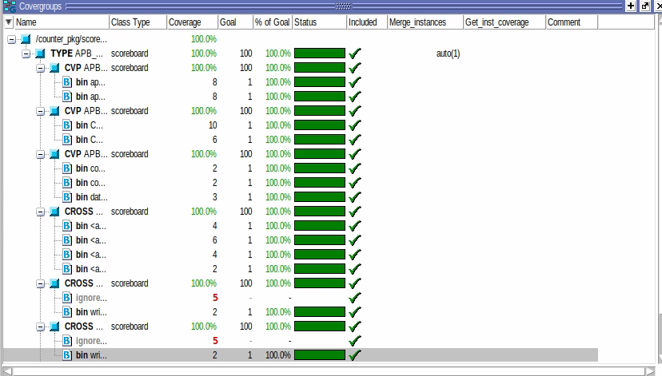

# APB Counter Verification — SystemVerilog Class-Based Testbench



> **Provenance and reproducibility:** This is a **reconstructed portfolio-ready reference project** based on screenshots of a student's APB counter verification coursework. The **original RTL files, complete source code, Questa logs, and UCDB databases were not provided**. Some implementation files in this repository were newly written to produce a self-contained example, and **this reconstructed project has not been executed or verified in QuestaSim in the packaging environment**. The screenshot records **100% merged functional coverage achieved on the user's original remote-server project**, not an independently verified result for these reconstructed sources.

## Project overview

A lightweight, **non-UVM** SystemVerilog object-oriented verification environment for an APB-like 8-bit up/down counter. Test selection uses plusargs and polymorphism; constrained-random addresses exercise two registers; a monitor sends transactions to a coverage-collecting scoreboard.

### Verification architecture


```text
  Test class (base_test and derived scenarios)
                 |
          write() / read()
                 v
              Stimulus
                 |  mailbox #(packet)
                 v
              Driver ----> virtual dut_if ----> APB Counter DUT
                 ^                                  |
                 |                              bus signals
                 |                                  v
             xfer_done                           Monitor
                                                    |
                                            mailbox #(packet)
                                                    v
                                          Scoreboard / Coverage
                                                  APB_GROUP
```

**Scope:** functional coverage of bus transactions and selected register-write scenarios. `scoreboard.sv` records and samples transactions; it **does not include a golden reference model or read-data comparisons**. A reported coverage goal therefore does not by itself demonstrate design correctness.

## Directory structure

```text
APB_Counter_SystemVerilog_DV/
├── rtl/                 # Reconstructed APB counter RTL (not original server files)
│   ├── register.vp
│   ├── counter.vp
│   └── basic_counter.vp
├── tb/                  # Class-based components and top-level testbench
│   ├── packet.sv
│   ├── stimulus.sv
│   ├── driver.sv
│   ├── monitor.sv
│   ├── scoreboard.sv
│   ├── coverage.sv
│   ├── environment.sv
│   ├── dut_interface.sv
│   ├── counter_pkg.sv
│   └── testbench.sv
├── testcase/            # Base test and four derived scenarios
│   ├── base_test.sv
│   ├── count_up_test.sv
│   ├── count_down_test.sv
│   ├── count_up_with_data_test.sv
│   ├── count_down_with_data_test.sv
│   └── test_pkg.sv
├── sim/                 # QuestaSim compile, run and coverage targets
│   ├── Makefile
│   ├── compile.f
│   ├── tb.f
│   └── project_env.bash
└── docs/
    ├── images/functional_coverage_100.png
    ├── COVERAGE_EVIDENCE.md
    ├── IMPLEMENTATION_NOTES.md
    └── INTERVIEW_TALKING_POINTS.md
```

## Feature/test matrix

| Scenario | Plusarg | Intended sequence |
| --- | --- | --- |
| Up | `+count_up_test` | CCR = `0x01`, read random address 0 or 1 |
| Down | `+count_down_test` | CCR = `0x03`, read random address 0 or 1 |
| Up + preload | `+count_up_with_data_test` | Disable, CDR = 100, CCR = `0x01`, read |
| Down + preload | `+count_down_with_data_test` | Disable, CDR = 100, CCR = `0x03`, read |

## Running locally with QuestaSim

**Prerequisite:** QuestaSim / ModelSim with SystemVerilog OOP, covergroups, and `vcover`. The script settings mirror the supplied screenshots of QuestaSim 10.6d; command-line options can vary across versions.

```bash
cd sim
make build
make run TESTNAME=count_up_test
make run TESTNAME=count_down_test
make run TESTNAME=count_up_with_data_test
make run TESTNAME=count_down_with_data_test
make cov_merge
make cov_report
make cov_gui
```

Or run the full regression:

```bash
cd sim
make regress
```

Simulation runs should generate four `*.ucdb` databases, separate `*.log` files, `IP_MERGE.ucdb`, and a textual coverage report. These **generated artifacts are not included here**, because the user's originals remained on the remote server. The screenshot below is retained as the supplied historical evidence.

## Original reported functional coverage

The provided QuestaSim image displays a **100.0% coverage result** for the merged `IP_MERGE` dataset. It shows coverage categories for transfer type, address, write data, APB transaction cross, and count up/down feature crosses. This is a statement about the **provided screenshot**; the reconstructed files require a new run before making a fresh coverage claim. **Important numeric issue:** the original screenshots included an `8'h100` literal warning (which truncates to 8'h00), whereas this reconstruction uses `8'd100`. See [Implementation notes](docs/IMPLEMENTATION_NOTES.md).


See [Coverage evidence and limitations](docs/COVERAGE_EVIDENCE.md).

## Key SV concepts demonstrated

- **Inheritance and polymorphism:** derived tests override `virtual task run_scenario()`; a `base_test` handle selects the active scenario.
- **APB setup and access phases:** the driver controls `PSEL`, `PENABLE`, `PWRITE`, address and data.
- **Mailbox communication:** stimulus → driver → monitor → scoreboard.
- **`randc` and `inside`:** constrained-random address selection from two APB locations.
- **Functional coverage:** coverpoints, `iff`, named bins, cross bins and `ignore_bins`.
- **Regression:** test-specific UCDB collection and explicit merge using `vcover`.

## Future engineering work

1. Replace reconstructed `rtl/` and component implementations with the **actual original source files**.
2. Run the full regression in QuestaSim and verify **zero assertion failures**.
3. Add a reference-model scoreboard, protocol assertions, and read-data/interrupt checks.
4. Publish regenerated UCDB reports or coverage summaries for this exact public commit.

## Attribution

Packaged from user-supplied coursework screenshots with clearly marked reconstructed code. It is not represented as UVM or as an independently validated formal/functional proof.
