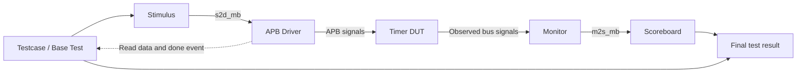

# APB 8-bit Timer | Design Verification

**Specification-driven verification of an APB-controlled 8-bit up/down timer using a reusable, class-based SystemVerilog testbench.**


## 1. Project overview

This IP-level verification project focuses on the functional correctness of a programmable timer peripheral through its APB register interface and interrupt output. It follows a specification-driven verification workflow, from test planning and stimulus generation to self-checking and regression automation.

| Project attribute | Description |
| --- | --- |
| DUT | APB-controlled 8-bit up/down timer |
| Methodology | Object-oriented SystemVerilog (non-UVM) |
| Verification plan | 24 scenarios across four functional areas |
| Stimulus | 21 directed and 3 constrained-random scenarios |
| Checking | Register shadow model, explicit scenario checks, interrupt observation |
| Simulation target | Siemens Questa on the ICTC training server |

**Project scope:** verification environment and test scenarios based on ICTC Project 1. The protected DUT RTL is supplied separately by ICTC and is not distributed in this repository. A successful build or complete regression of this revision has not been established; see [Current status and limitations](#8-current-status-and-limitations).

## 2. Design under test (DUT)

The timer is configured through an 8-bit APB address/data interface. The timer kernel clock is divided to control the counting rate. Overflow and underflow events update status flags and can generate an interrupt according to the interrupt enable register.

<p align="center">
  
</p>

*Figure 1. APB timer DUT architecture.*

### Register map

| Address | Register | Fields / behavior |
| --- | --- | --- |
| `0x00` | TCR — Timer Configuration Register | `clk_div[4:3]`, `load[2]`, `count_down[1]`, `timer_en[0]` |
| `0x01` | TSR — Timer Status Register | `underflow[1]`, `overflow[0]`; hardware-set, write-one-to-clear (W1C) |
| `0x02` | TDR — Timer Data Register | `data[7:0]`; counter preload value |
| `0x03` | TIE — Timer Interrupt Enable Register | `underflow_en[1]`, `overflow_en[0]` |
| `0x04–0xFF` | Reserved | Expected to ignore writes and return zero on reads |

Overflow occurs on the `255 → 0` transition; underflow occurs on `0 → 255`. Writing a 1 to a TSR status bit clears that bit; writing a 0 leaves it unchanged in the absence of a hardware event. TDR is preload data, not a live counter readout.

### Clock and reset configuration

- APB clock (`pclk`): 50 MHz, 20 ns period.
- Timer kernel clock (`ker_clk`): 200 MHz, 5 ns period.
- Reset (`presetn`): active low.

| TCR divider | Tick frequency | Tick period | Nominal full 256-count wrap interval |
| --- | ---: | ---: | ---: |
| `00` (/1) | 200 MHz | 5 ns | 1,280 ns |
| `01` (/2) | 100 MHz | 10 ns | 2,560 ns |
| `10` (/4) | 50 MHz | 20 ns | 5,120 ns |
| `11` (/8) | 25 MHz | 40 ns | 10,240 ns |

The table gives theoretical timing targets, not measured simulation results.

## 3. Verification environment

<p align="center">
  
</p>

*Figure 2. Class-based verification environment.*



| Component | Responsibility |
| --- | --- |
| [Packet](tb/packet.sv) | Encapsulates APB operation, address, data, read response and completion event. |
| [Stimulus](tb/stimulus.sv) | Queues transaction objects and forwards them to the driver. |
| [Driver](tb/driver.sv) | Drives APB SETUP and ACCESS on falling edges; samples completion at the rising edge and checks PREADY. |
| [Monitor](tb/monitor.sv) | Independently samples completed APB transfers and observes interrupt rising edges. |
| [Scoreboard](tb/scoreboard.sv) | Updates expected register fields from observed writes and compares actual readback. |
| [Environment](tb/environment.sv) | Connects components, handles reset, tracks checks and reconciles transaction counts. |
| [Base test](testcase/base_test.sv) | Provides reusable read/write helpers, lifecycle and final checks. |
| [Top-level testbench](tb/testbench.sv) | Instantiates DUT, generates clocks and selects derived tests through `+TESTNAME`. |

### Self-checking strategy

The scoreboard tracks TCR configuration fields, TDR and TIE using observed APB transactions. Hardware-generated TSR flags, timer behavior and interrupt conditions are checked explicitly by the test scenarios, rather than inferred from register writes.

The final result checks that:

- At least one check was executed.
- Driver, monitor and scoreboard transaction counts agree.
- No scoreboard or scenario errors were recorded.

## 4. Verification plan

The [original VPlan spreadsheet](docs/NguyenVanThuongVplan.xlsx) defines 24 scenarios. Each planned test is associated with a dedicated SystemVerilog test file; the [verification matrix](docs/VERIFICATION_MATRIX.md) provides the full traceability list.

| Functional area | Directed | Random | Total | Verification objectives |
| --- | ---: | ---: | ---: | --- |
| Register interface | 6 | 1 | 7 | Reset, read/write, reserved fields, W1C, selective clear |
| Clock divider | 4 | 0 | 4 | /1, /2, /4, /8; wrap timing |
| Counter | 6 | 1 | 7 | Preload, enable/disable, up/down, overflow, underflow |
| Interrupt | 5 | 1 | 6 | Overflow/underflow IRQ, masking, independence, polling |
| **Total** | **21** | **3** | **24** | |

### Verification plan evidence


*Figure 3. Original 24-scenario verification plan.*

### Example: clock divider verification

The implemented divider scenarios use a black-box approach: configure the timer, poll TSR for a wrap event, clear the flag using W1C, then measure the interval to the next wrap. This avoids relying on an internal counter signal that is not exposed by the DUT.

For example, the nominal /4 wrap interval is `256 × 20 ns = 5,120 ns`. The /4 test accepts a ±30% interval window to accommodate the coarse APB polling method. This checks approximate counting rate, not exact clock phase or duty cycle.

### Constrained-random stimulus

Random scenarios exercise register accesses, timer configuration and interrupt masks. The timer configuration class biases initial values toward boundary cases (`0x00`, `0x01`, `0xFE`, `0xFF`) while still exploring the middle range.

## 5. Repository structure

```text
APB_Timer8bit/
├── tb/                       # Reusable verification components and top
├── testcase/                 # Base test and feature-specific scenarios
├── sim/
│   ├── Makefile.dv            # Compile, run, waveform and clean targets
│   ├── regress.py             # Python regression runner
│   ├── regress.cfg            # ICTC regression configuration
│   └── *.f                    # RTL and testbench file lists
├── docs/                     # VPlan, test manifest, review and learning notes
├── future/                   # Functional coverage and SVA prototypes
├── rtl/                      # Protected RTL instructions (no DUT sources)
├── tools/                    # Static project consistency checker
└── install_into_ictc_project.sh
```

## 6. Build and run

### Prerequisites

- Linux shell, GNU Make and Python 3.
- Questa tools (`vlog`, `vsim`, `vlib`, `vmap`) available on PATH.
- Existing ICTC project with authorized protected timer RTL and project directories.

### Installation

From a local clone on the ICTC server:

```bash
git clone https://github.com/thuongnguyen4405/APB_Timer8bit.git
cd APB_Timer8bit
bash install_into_ictc_project.sh ~/project_dva/project1
cd ~/project_dva/project1/sim
```

Review [WHAT_CHANGED.md](docs/WHAT_CHANGED.md) and the installer before copying into an existing project. The installer preserves the RTL and original Makefile, but replaces selected verification and simulation files. Keep a separate backup of local modifications. Source `project_env.bash` if required by your server.

### Compile and run a single test

```bash
make -f Makefile.dv build
make -f Makefile.dv run TESTNAME=register_reset_test SEED=1
make -f Makefile.dv run TESTNAME=register_rw_test SEED=1
```

### Regression and waveform debug

```bash
# Smoke regression
python3 regress.py --quick

# Full planned regression; three seeds for each random test
python3 regress.py --seeds 3

# Interactive waveform
make -f Makefile.dv wave TESTNAME=register_rw_test SEED=1
```

The commands describe the intended workflow; resolve the source issue in Section 8 before building. The original ICTC Perl regression tool is not included in this repository.

Logs are stored in `sim/log/`, with a CSV summary generated at `sim/log/regression_summary.csv`. The Python runner checks the exit code and the test's PASS/FAIL message.

## 7. Simulation evidence and coverage

The following screenshots were included in the original project documentation. They are retained as historical evidence, not as proof that the current Git revision passes.

### Register read/write test


*Figure 4. Register read/write simulation evidence.*

### Register reset test


*Figure 5. Register reset simulation evidence.*

### Coverage evidence

**Overall coverage report**


*Figure 6. Overall coverage report.*

**cg_test coverage report**


*Figure 7. cg_test coverage report.*

The original notes identify gaps related to reserved register fields/addresses. In the current source tree, functional covergroups and APB assertions are present under [future/](future/) but are not integrated into the active testbench file list. No current coverage percentage or closure claim is made.

## 8. Current status and limitations

| Item | Status |
| --- | --- |
| VPlan and testbench structure | Present; 24 planned test names |
| Compile / full regression | Not verified for this revision |
| Known source issue | [clock_div1_test.sv](testcase/clock_div1_test.sv) declares `clock_div8_test` instead of `clock_div1_test`; correct the class and /1 scenario before compiling. |
| Counter checking | Black-box status and timing checks; no cycle-by-cycle internal counter visibility |
| Functional coverage / SVA | Prototype code, not enabled in the current build |
| DUT integration | Requires ICTC-provided RTL |

Further work: resolve the divider source mismatch, run smoke tests and full regression, record reproducible logs and bug reports, integrate functional coverage and protocol assertions, and close coverage gaps against the VPlan.

## 9. References

- [Verification plan (Excel)](docs/NguyenVanThuongVplan.xlsx)
- [Verification matrix](docs/VERIFICATION_MATRIX.md)
- [RTL review and open questions](docs/RTL_REVIEW_OPEN_POINTS.md)
- [Functional coverage integration notes](docs/COVERAGE_LATER.md)
- [Vietnamese base test flow](docs/BASE_TEST_FLOW_VN.md)

**Acknowledgment:** ICTC Design Verification training — Project 1. Protected RTL and training specifications remain with their respective owners.
